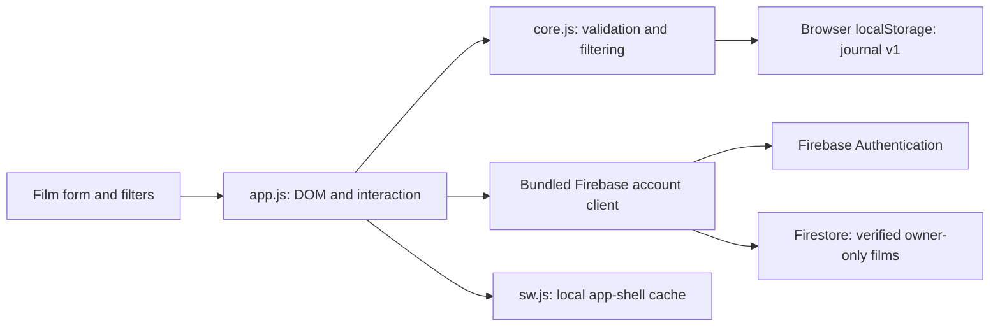

# Frame

A personal film journal for manual entries, ratings from 0–10, short reviews, and filtering by score, genre or date watched. Includes editing, confirmed removal, title search, sorting, statistics, and a separate sample journal. Film-search data is deferred.

**Use the app:** [Open Frame](https://sadaquekhanprojects.github.io/movie-rating-web-app/). No account or installation is needed. [CI/CD runs](https://github.com/SadaqueKhanProjects/movie-rating-web-app/actions/workflows/pages.yml) show validation and deployment status.

## Interface

Frame opens directly into a dark watch diary: dates on the left, reviews in the middle, and scores on the right. Search is always available; genre, score and date filters appear behind **Filters**, with an active-filter count. Each entry’s **•••** button opens Edit and Remove. The short logging form supports keyboard input, returns focus when closed, and keeps confirmation for removal. Small screens put the review below the title so it has room to read.

## Accounts rollout

Private email accounts and synced diaries are implemented on this branch and tested with local Firebase emulators. Production activation still requires an authorized Firebase Spark project, deployed owner-only rules and web configuration. The existing live site stays browser-local until that setup and live verification are complete. See [account setup, privacy and test instructions](docs/accounts.md).

## Run the system

Prerequisites: Python 3 (tested 3.13.3), Node 24.12–24.x (tested 24.22.2; see `.nvmrc`) and npm. Java 21 is required for Firebase emulator integration tests. Guest mode needs no live account or project; synced accounts need the setup described above.

```sh
git clone https://github.com/SadaqueKhanProjects/movie-rating-web-app.git
cd movie-rating-web-app
npm ci
npm run build
npm start
```

Open **http://127.0.0.1:4173**. You should see the empty Frame journal; choose **Log a film** or explore the labelled sample journal. Stop the server with **Ctrl+C** in its terminal.

## Command palette

Run from the checkout root:

| Task | Command | Expected result |
| --- | --- | --- |
| Install | `npm ci` | Locked dependencies |
| Build | `npm run build` | Generated browser account bundle and public config |
| Emulator tests | `npm run test:integration` | Owner-isolation and account checks using local demo services |
| Start | `npm start` | Static local server on port 4173 |
| Start without Node | `python3 -m http.server 4173 --bind 127.0.0.1 --directory dist` | Same server |
| Test | `npm test` | Domain, filter and storage tests pass |
| Syntax check | `npm run check` | JavaScript files parse |
| Stop | Ctrl+C in the server terminal | Server exits |

Run `npm ci` and `npm run build` before starting. `dist/` contains maintained browser files plus the generated account bundle; generated files are ignored and rebuilt by CI. The public repository uses GitHub Pages for hosting and GitHub Actions for CI/CD; see [deployment and free-use limits](docs/deployment.md). No paid plan, custom domain, subscription or external deployment secret is required.

## Data and privacy

Guest entries live in this browser profile's `localStorage`, scoped to this exact origin (scheme, host, port). The hosted site starts with a separate journal from the local preview; existing local entries are not automatically transferred. Use the same address each time: `localhost`, another port, a different browser, and another device each have separate journals. Clearing site data or private-browsing storage can permanently remove entries. Guest records have no automatic cloud sync or backup; anyone using this browser profile can read them. Configured private accounts sync through Firebase. Explicit browser-to-account import keeps the original local records; general backup/export is not implemented.

The first visit needs the local server. After the app shell has cached successfully, this origin can reload and save entries with the server stopped. Offline availability depends on browser service-worker support and retained site storage; opening the HTML as a `file:` URL is unsupported. Fonts, artwork, scripts and styles are local. Guest mode needs no external service. Configured accounts communicate with Firebase for authentication and private storage; no analytics integration is enabled. The sample journal never gets saved into your entries.

Failed saves keep the form and draft open and leave the last saved journal intact. Unsupported/corrupt stored data is preserved and editing is blocked. Observed changes from another tab refresh the collection; stale open forms cannot overwrite a changed storage snapshot. This is best-effort conflict detection: localStorage has no cross-tab transaction, so avoid simultaneous submissions in multiple tabs. See [architecture and recovery](docs/architecture.md).

## Architecture



`index.html` and `styles.css` provide responsive, keyboard-accessible presentation. `core.js` owns guest validation, storage serialization and filter rules. `account-model.js` and the bundled `src/firebase-client.js` add verified accounts, owner-only cloud storage, transaction revisions and explicit guest import. `app.js` renders text through DOM text nodes, without interpreting titles or reviews as HTML. Film-search integration can later map search results to the same validated form for user review; it must not overwrite manually entered data.

## Verification

See [validation evidence and limits](docs/validation.md). Unit/domain/storage tests, JavaScript syntax checks and local Firebase emulator integration checks pass. The redesigned UI was checked in the in-app browser at desktop and narrow widths, including combined filters, creating/editing, reload persistence, action menus, keyboard Escape/focus return, and removal confirmation/cancellation. The original offline workflow was checked in Chrome. The original release and redesign evidence is retained there; current CI/CD status is available through the workflow link above. No physical-device test is claimed.


## Contributing and deployment

Create an issue, branch as `feature/<issue-number>-<description>` (or another appropriate type), and use scoped Conventional Commits. Run the local checks, then open a PR to `main`. The `Validate` check must pass before merging. Merges to `main` run validation again and deploy only the checked `dist/` artifact. PRs never deploy. See [deployment](docs/deployment.md) for rollback, cost constraints and settings; enforcement depends on the repository's configured branch rules.
